<div align="center">

# 🦊 Media Streamer

**Self-hosted camera recorder that finds the moments that matter.**<br>
Record Tapo (or any RTSP) cameras, let GPU workers anywhere look for foxes, wildlife or
anything else, and keep the clips.


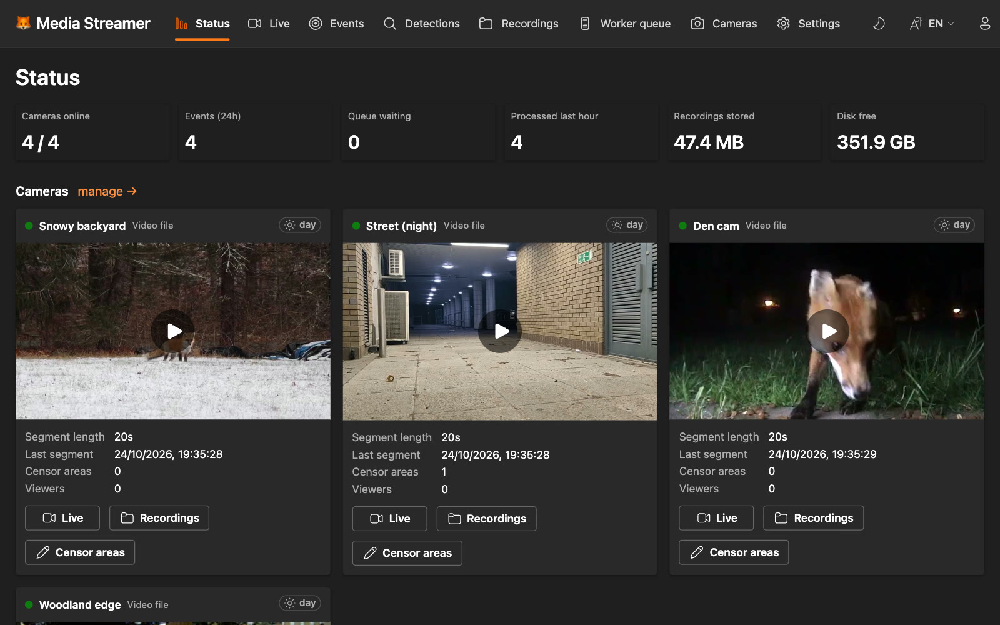

</div>

## Highlights

- **Record everything, keep what matters.** MediaMTX records each camera in segments of
  configurable length. Retention deletes ordinary footage after N days but keeps every
  segment that belongs to an event.
- **Detection runs anywhere.** Workers lease jobs over plain HTTP: a GPU PC at home, a
  Windows/WSL gaming machine, a Docker box or a SaaS adapter. No inbound ports on the
  worker, per-worker access tokens, automatic retries.
- **Detect anything with profiles.** A detection profile says *what* to look for (fox; car
  and person; …) and *which* workers may do it. Open-vocabulary models (YOLO-World) are
  prompted with each job's targets, so a new profile needs no new model and no worker
  restart; SpeciesNet knows ~2000 species.
- **Several models per profile.** Let YOLO-World and SpeciesNet both look (one event, with
  which models saw it), or chain them so an expensive model only confirms a cheap one's
  finds; notify only when models agree, and compare them under Detections → Models.
- **Privacy built in.** Draw censor rectangles per camera; they are burned into the pixels
  before a worker sees a frame, and optionally into recordings and live view as well.
  Private cameras are never sent anywhere.
- **Recording profiles and hourly files.** Short segments while recording (fast detection),
  joined into one file per camera and hour afterwards: far fewer files on disk and in S3.
  Per camera, keep the original stream or re-encode the hour smaller (1080p, 720p, 480p,
  1080p H.265 or your own), with its own retention.
- **Hardware video encoding.** Re-encoding uses Intel Quick Sync, NVIDIA NVENC, AMD (VAAPI /
  AMF) or Apple VideoToolbox when available, also in Docker, with automatic CPU fallback
  ([docs/HARDWARE.md](docs/HARDWARE.md)).
- **Events with clips.** Sightings close in time become one event with a clip cut from the
  original footage (with pre/post roll), a thumbnail with the box drawn, a day/night tag and
  ✅/❌ feedback for building a training set.
- **A UI for every screen.** Live view (WebRTC/HLS, with a ~480p *low data* mode for
  mobile connections), events, detections, recordings, worker queue and camera
  management, on phone, tablet and desktop, light or dark, in English and Swedish.
- **Tapo cloud cameras.** Stream cameras you can't reach on the LAN (say, at the summer
  house) through the TP-Link cloud, kept alive with the same heartbeats the Tapo app sends.
- **Notifications and webhooks.** Push to your phone with ntfy, call Home Assistant or any
  webhook (HMAC-signed JSON), or notify Telegram, Discord, Pushover and ~100 more via
  Apprise — with an image of the detection, quiet hours and per-camera cooldown.
- **Optional S3.** Copy clips and recordings to AWS S3, Cloudflare R2, Backblaze B2,
  MinIO…, served through short-lived signed links.

## Screenshots

<table>
  <tr>
    <td width="50%">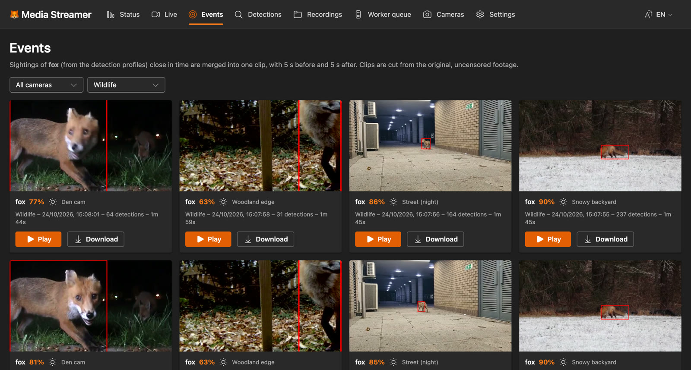</td>
    <td width="50%">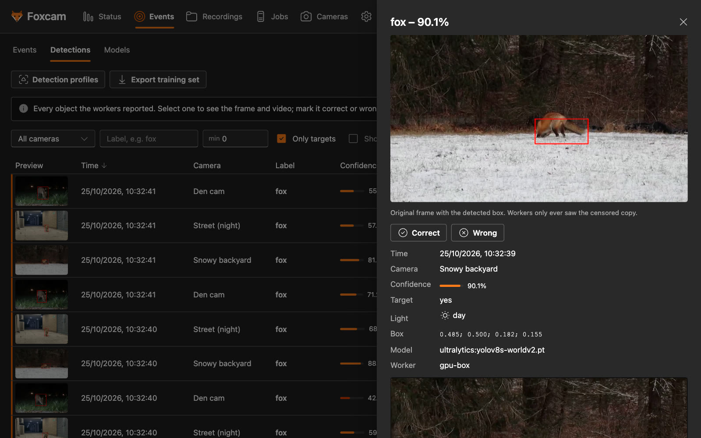</td>
  </tr>
  <tr>
    <td><b>Events</b> – one clip per sighting, filterable by camera and profile</td>
    <td><b>Detections</b> – every hit with its frame, box, model and ✅/❌ feedback</td>
  </tr>
  <tr>
    <td>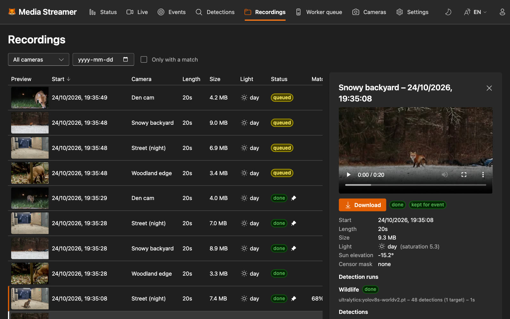</td>
    <td>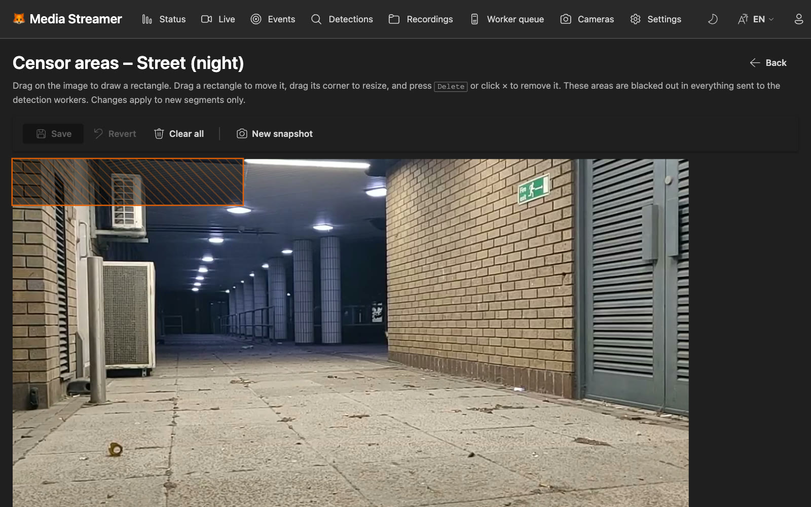</td>
  </tr>
  <tr>
    <td><b>Recordings</b> – every segment with day/night tag and match, kept segments pinned</td>
    <td><b>Censor areas</b> – drawn on a snapshot, blacked out before detection</td>
  </tr>
  <tr>
    <td>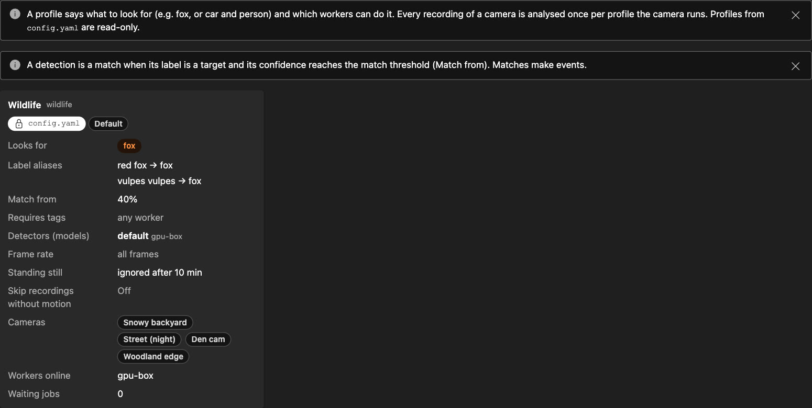</td>
    <td>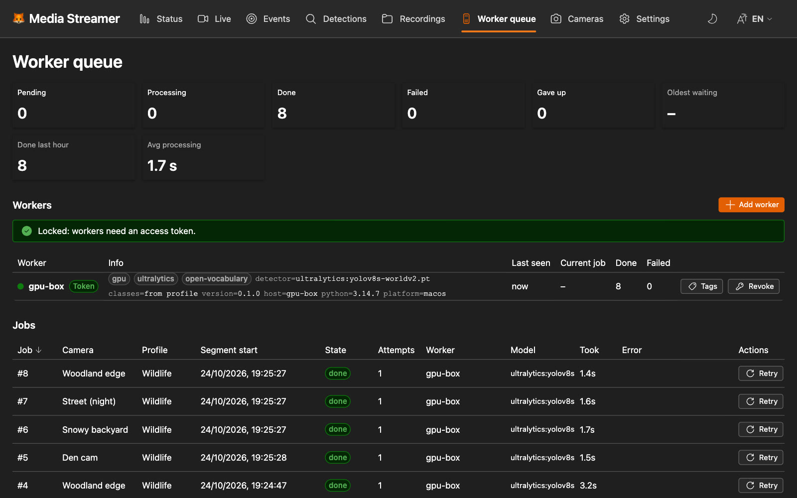</td>
  </tr>
  <tr>
    <td><b>Detection profiles</b> – what to look for and which workers may do it (Cameras page)</td>
    <td><b>Jobs</b> – the detection queue per profile, workers with their tags and tokens</td>
  </tr>
</table>

<p align="center">
  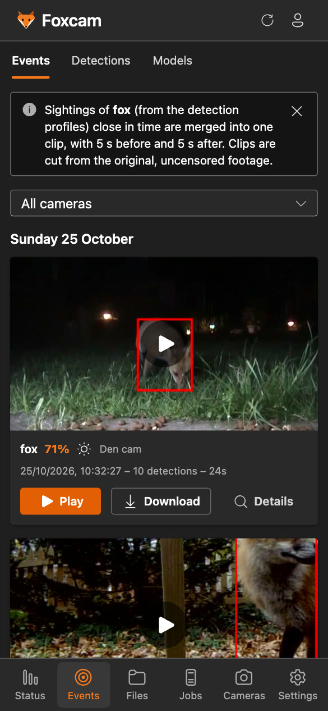
  &nbsp;
  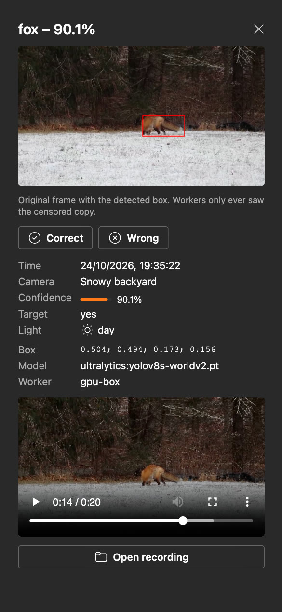
  &nbsp;
  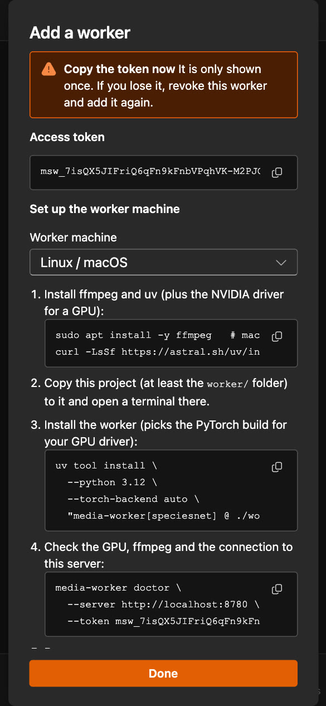
</p>

## How it works

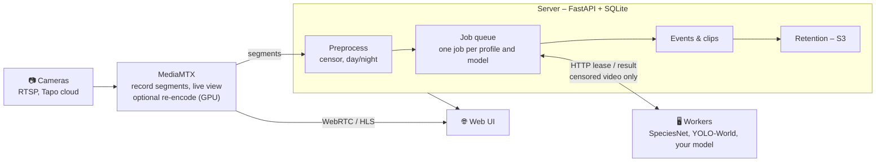

1. **MediaMTX** pulls each camera, records fixed-length segments and serves the live view.
   Cameras with burned-in censor areas pass through a transcode stage first (on the GPU
   when there is one), as does the low-data live view.
2. The **server** registers each segment, tags day/night, burns in the censor areas and
   creates one job per detection profile (and model) of the camera.
3. **Workers** lease jobs, run their detector on the censored, down-sampled video and post
   the detections back.
4. Target detections become **events**. Their clips are cut from the original footage and
   the segments are kept until the event expires.
5. **Compaction** (`media-streamer compact`, its own process) joins each finished hour into
   one file per camera, re-encoding it when the camera's recording profile says so.

Details: [docs/ARCHITECTURE.md](docs/ARCHITECTURE.md).

## Quick start

Requirements: [mise](https://mise.jdx.dev), [uv](https://docs.astral.sh/uv/),
[pnpm](https://pnpm.io) and `ffmpeg`.

```sh
mise run setup      # Python + web deps, config.yaml, MediaMTX binary, fox sample clips
mise run dev        # MediaMTX, server, ingest, web UI and a dummy worker (live reload)
mise run seed       # in another terminal: one fake camera per sample clip
```

Open **http://localhost:5173**, or the LAN address `dev` prints (`http://192.168.x.y:5173`)
from another computer or phone: live view and notification links follow along. The first
visit asks for the setup code the server prints in its log (also in `data/setup-code`) and
creates the admin account. The dummy worker pretends to see a fox now and then, enough
to watch the whole pipeline work. For real detection on your machine:

```sh
mise run setup:yolo && mise run dev:yolo     # YOLO-World (uses CUDA when available)
```

### Docker

```sh
cp config.example.yaml config.yaml          # add your cameras
docker compose up --build -d                # MediaMTX + server (with UI) + ingest on :8000
docker compose logs server | grep "setup code"   # for the first (admin) account

# With a GPU for video encoding (see docs/HARDWARE.md):
docker compose -f docker-compose.yml -f docker-compose.vaapi.yml up --build -d   # Intel / AMD
docker compose -f docker-compose.yml -f docker-compose.nvidia.yml up --build -d  # NVIDIA
```

Live view goes through the server (behind the login), so only port 8000 and the WebRTC
media port 8189 (TCP, no UDP needed) have to be reachable. In Docker, add the host's LAN IP
to `webrtcAdditionalHosts` in `mediamtx/mediamtx.yml` so WebRTC can connect from other
devices, and set `public_url` for links in notifications. Check which video encoder the
container can use with `docker compose exec mediamtx media-streamer hwaccel`.

## Adding cameras

Use **Cameras → Add camera** in the web UI; cameras start recording within seconds, no
restart needed. Each camera card then has its own settings: **Censor areas**, **Detection**
(which profiles run) and **Recording** (quality profile and retention).

- **RTSP** – the robust option when the server can reach the camera (same network, or a VPN
  such as Tailscale). In the Tapo app create a *Camera Account* (camera → Settings →
  Advanced settings → Camera account); the dialog builds the `rtsp://…/stream1` URL and
  tests it.
- **Tapo cloud** – works from anywhere, like the Tapo app. Sign in with your Tapo account
  under **Cameras → Integrations** (two-step verification supported) and add cameras from
  the list. Needs the `tapo-cloud` extra (in the
  Docker image). It uses the unofficial [ontapo](https://pypi.org/project/ontapo/) library
  and about 1–2 Mbit/s of upload per HD camera at the camera's site.
- **Test sources** – a looping video file or a test pattern, for development.

Cameras can also be defined in `config.yaml` (see [`config.example.yaml`](config.example.yaml)).

<details>
<summary>Testing the Tapo cloud stream without sharing credentials</summary>

Your Tapo password is only ever typed into a local prompt (or the local web UI) and sent
straight to TP-Link. What is stored is a session token in `data/tapo-session.json`
(mode 0600, git-ignored), which is as sensitive as the password. The server refreshes the
token by itself when it expires; only if TP-Link rejects the refresh (for example after a
password change) are the cloud cameras paused until you sign in again.

```sh
uv run media-streamer tapo-login      # e-mail, password (hidden), then the MFA code
uv run media-streamer tapo-check      # lists cameras, records 10 s, prints codec/size only
uv run media-streamer tapo-logout     # delete the saved session
```

`tapo-check` prints no secrets and is safe to share when asking for help.
</details>

## Workers and models

A worker runs wherever the GPU is and only needs to reach the server over HTTP. Create a
token under **Jobs → Add worker**: the dialog shows ready-to-paste commands for
Windows + WSL 2, native Windows, Linux/macOS and Docker. For example:

```sh
uv tool install --python 3.12 --torch-backend auto "media-worker[speciesnet] @ ./worker"
media-worker doctor --server http://<server>:8000 --token msw_…   # checks ffmpeg, GPU, token
media-worker --server http://<server>:8000 --token msw_… --detector speciesnet
```

| Detector | Good at | Notes |
|---|---|---|
| **SpeciesNet** (Google) | wildlife incl. night/IR, ~2000 species | the most accurate for foxes in our tests |
| **YOLO-World** (Ultralytics) | any object you can name | prompted with each job's profile targets (no `--classes` needed); fast on a GPU |
| **Your own** | anything | implement one method, or speak the [HTTP protocol](docs/WORKER_PROTOCOL.md) from any language or SaaS |

Measured results on fox footage: [docs/MODELS.md](docs/MODELS.md). GPU setup on
Windows/WSL, Docker and Linux: [docs/WORKER_SETUP.md](docs/WORKER_SETUP.md).

## Configuration

Everything lives in `config.yaml` (`${ENV_VAR}` references are expanded). Cameras,
detection profiles, censor areas and worker tokens can also be managed in the UI.

| Section | What it controls |
|---|---|
| `cameras` | sources, per-camera segment length, which profiles run, recording profile |
| `profiles` | targets, aliases, confidence, required worker tags, detectors (several models per profile, cascades that confirm), frame rate, event retention |
| `recording_profiles` | extra recording qualities (resolution, fps, bitrate, H.264/H.265, `keep_days`) next to the built-in original, 1080p, 720p, 480p and 1080p H.265 |
| `mediamtx` | addresses, low-data live view, hardware encoding (`hwaccel`, [guide](docs/HARDWARE.md)) |
| `processing` | frames per second sent to workers, resolution, night detection threshold |
| `queue` | lease time, retries |
| `events` | pre/post roll, merge gap |
| `retention` | how long to keep footage, events and unprocessed segments; disk cap |
| `compaction` | joining finished segments into hourly files (period, delay, on/off) |
| `storage.s3` | S3-compatible bucket for clips and recordings |
| `notifications` | ntfy / webhook / Apprise channels, filters, quiet hours ([guide](docs/NOTIFICATIONS.md)) |
| `public_url` | how you open the UI; used for links in notifications |
| `auth` | accounts: registration (invite / open / closed), admin e-mails, OAuth providers ([guide](docs/AUTH.md)) |
| `location` | coordinates (sun elevation) and country (SpeciesNet geofencing) |

## Development

`mise tasks` lists everything. The most useful ones:

| Task | What it does |
|---|---|
| `setup`, `setup:yolo`, `setup:speciesnet` | install dependencies (plus a detector for a local worker) |
| `dev`, `dev:no-worker`, `dev:yolo` | whole stack with a dummy / no / YOLO-World worker, live reload |
| `server`, `ingest`, `compact`, `mediamtx`, `web`, `worker*` | one part at a time |
| `stop` | kill anything left on the dev ports |
| `build` | build the web UI that the server serves on :8000 |
| `tapo:login`, `worker:token` | sign in to the Tapo cloud; create a worker token |
| `user:add`, `user:password`, `user:list` | manage accounts from the command line |
| `seed` (`-- --profiles`) | fake cameras from `samples/` (and an example profile) |
| `cameras:remove-test` | remove the test cameras and the data of removed cameras |
| `check` | ruff, oxlint, typecheck, oxfmt and all tests |
| `doctor` | check ffmpeg, GPU, detectors and the connection to the server |
| `s3:local` | a local S3 server to try `storage.s3` |
| `screenshots` | regenerate `docs/screenshots` from a throwaway demo stack (sample clips, YOLO-World if installed) |
| `docker:up`, `docker:test` | Docker stacks (the test stack runs next to dev on :18000) |
| `reset:events`, `reset:detections`, `reset:queue`, … | delete one kind of data, keep the rest |
| `reset`, `clean:all` | wipe all data – back to a fresh checkout |

`uv run media-streamer --help` lists the server commands, e.g. `hwaccel` (which video
encoders work here), `worker-token`, `remove-cameras` and `reset`.

| Part | Stack |
|---|---|
| [`server/`](server) | Python, FastAPI, SQLAlchemy + SQLite, ffmpeg |
| [`worker/`](worker) | Python, pluggable detectors (SpeciesNet, Ultralytics, dummy) |
| [`web/`](web) | React 19, Fluent UI v9, Vite, React Compiler, TanStack Query, oxlint, oxfmt |
| [`mediamtx/`](mediamtx) | MediaMTX config (RTSP ingest, recording, WebRTC/HLS); paths are pushed by the server |

## Documentation

| | |
|---|---|
| [Architecture](docs/ARCHITECTURE.md) | pipeline, detection and recording profiles, data model, retention, S3, privacy |
| [Worker setup](docs/WORKER_SETUP.md) | GPU workers on Windows/WSL, Docker and Linux |
| [Worker protocol](docs/WORKER_PROTOCOL.md) | HTTP API for workers and SaaS adapters |
| [Models](docs/MODELS.md) | detection models compared on fox footage |
| [Hardware encoding](docs/HARDWARE.md) | Quick Sync, NVENC, AMD, VideoToolbox; Docker GPU setup |
| [Notifications](docs/NOTIFICATIONS.md) | ntfy, webhooks (payload, signatures, Home Assistant) and Apprise |
| [Authentication](docs/AUTH.md) | accounts, OAuth, camera sharing and what is protected how |
| [Roadmap](docs/ROADMAP.md) | planned work |

## Security

Everything except the worker API needs a login (e-mail and password and/or Google,
Microsoft, GitHub or any OpenID Connect provider). Users only see the cameras shared with
them; live view is served through the server, and MediaMTX only accepts local processes.
Workers need an access token, camera passwords are redacted in the API, and workers only
ever receive censored footage. Put TLS in front (e.g. Caddy) before exposing it to the
internet. Details: [docs/AUTH.md](docs/AUTH.md).

## Credits

The screenshots show four Wikimedia Commons clips used as test cameras, with detections by
YOLO-World: *Red fox playing with prey in yard* by Peter Cooper Jr. (CC0), *Urban fox at
night* by Domdomegg (CC BY 4.0), *Fox Family Cam* by Huw (CC BY-SA 2.0) and *Red Fox 2012 11*
by Greenmars (CC BY-SA 3.0). `scripts/fetch_samples.py` downloads them and writes
`samples/CREDITS.md`.
