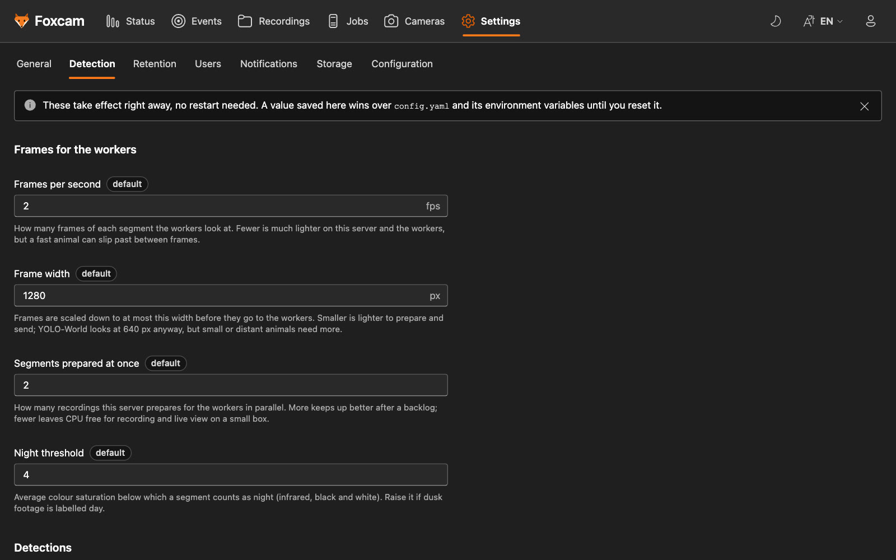
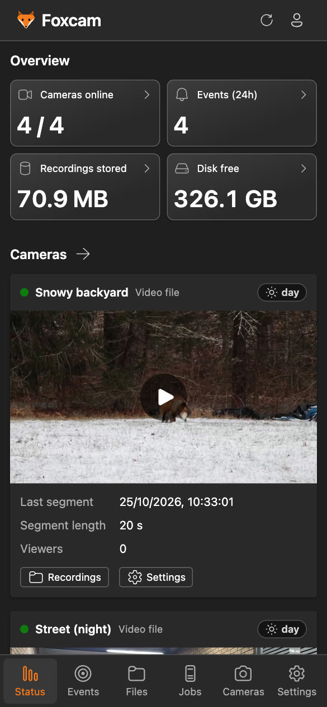
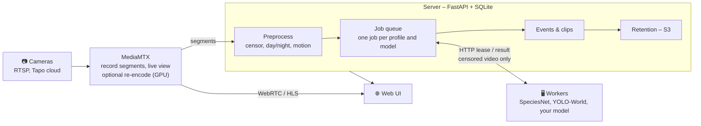

<div align="center">

# 🦊 Foxcam

**Self-hosted camera recorder that finds the moments that matter.**<br>
Record Tapo (or any RTSP) cameras, let GPU workers anywhere look for foxes, wildlife or
anything else, and keep the clips.


</div>

## Highlights

- **Record everything, keep what matters.** MediaMTX records each camera in segments of
  configurable length. Retention deletes ordinary footage after N days but keeps every
  segment that belongs to an event.
- **Detection runs anywhere.** Workers lease jobs over plain HTTP: a GPU PC at home, a
  Windows/WSL gaming machine, a Docker box or a SaaS adapter. No inbound ports on the
  worker, per-worker access tokens, automatic retries.
- **Detect anything with profiles.** A detection profile says *what* to look for (fox; car
  and person; …) and *which* workers may do it. Open-vocabulary models (YOLO-World) are
  prompted with each job's targets, so a new profile needs no new model and no worker
  restart; SpeciesNet knows ~2000 species. Each target can have its own match threshold
  (a high one for `person`, a low one for animals you don't want to miss).
- **Several models per profile.** Let YOLO-World and SpeciesNet both look (one event, with
  which models saw it), or chain them so an expensive model only confirms a cheap one's
  finds; notify only when models agree, and compare them under Events → Models.
- **Motion detection.** Targets standing still stop counting after a while (a parked car,
  a fox-shaped stump), and recordings where nothing moved can be skipped (no GPU time spent
  on quiet cameras). Per camera: sensitivity and areas to ignore, like trees in the wind.
  Events → Motion shows, from your own recordings and correct/wrong marks, where each
  option would help before you turn it on.
- **Sun limit.** A camera behind a window sees the lit room reflected in it after dark.
  Per camera, targets seen while the sun is below a limit are kept but count as no match;
  a chart of the sun's height through the day, with the camera's detections and your
  correct/wrong marks on it, shows where to put the limit.
- **Privacy built in.** Draw censor rectangles per camera; they are burned into the pixels
  before a worker sees a frame, and optionally into recordings and live view as well.
  Private cameras are never sent anywhere.
- **Recording profiles and hourly files.** Short segments while recording (fast detection),
  joined into one file per camera and hour afterwards: far fewer files on disk and in S3.
  Per camera, or as the default recording quality for all, keep the original stream or
  re-encode the hour smaller (1080p, 720p, 480p, 1080p H.265 or your own), with its own
  retention.
- **Hardware video encoding.** Re-encoding uses Intel Quick Sync, NVIDIA NVENC, AMD (VAAPI /
  AMF) or Apple VideoToolbox when available, also in Docker, with automatic CPU fallback
  ([docs/HARDWARE.md](docs/HARDWARE.md)).
- **Events with clips.** Sightings close in time become one event with a clip cut from the
  original footage (with pre/post roll), a thumbnail, a day/night tag and ✅/❌ feedback
  for building a training set. Detection boxes are drawn over the pictures and the playing
  video (with label and confidence, marked on the timeline, and a button to hide them),
  not burned in; only notification images have the box in the picture. A detection marked wrong is no match anywhere
  (counts, events, notifications, archives), and something that stands still (a parked
  car, ten minutes by default) stops making events.
- **Filters.** Events and detections filter by camera, profile, label, period (the last
  day, week or month, or any From – To), day or night, and how they were marked
  (correct, wrong, not yet); detections also by detector, confidence and standing still.
- **Favorites and bulk actions.** Star events and detections (in the lists and their
  drawers) and filter on them; starred events are never expired. Pick several rows or
  cards (Shift for a range) and mark them correct, wrong or favorite at once, or run
  detection again on their recordings.
- **A UI for every screen.** Live view (WebRTC/HLS, with a ~480p *low data* mode for
  mobile connections), events, detections, recordings, worker queue, camera management and
  settings, on phone, tablet and desktop, light or dark, in English and Swedish. On an
  iPhone or iPad, add it to the home screen and it runs full screen like an app, with a
  bottom tab bar, a refresh button and downloads handed to Safari.
- **Accounts and sharing.** E-mail and password or OAuth sign-in, cameras shared per user
  as viewer, editor or owner, and API keys with scopes for scripts and Home Assistant.
- **Tapo cloud cameras.** Stream cameras you can't reach on the LAN (say, at the summer
  house) through the TP-Link cloud, kept alive with the same heartbeats the Tapo app sends.
- **Notifications and webhooks.** Everyone gets their own push notifications from Foxcam
  itself (web push, also the iOS home screen app), with their own rules and only their
  cameras. Shared channels push with ntfy, call Home Assistant or any webhook (HMAC-signed
  JSON), or notify Telegram, Discord, Pushover and ~100 more via Apprise, with an image of
  the detection, quiet hours and per-camera cooldown.
- **Optional S3.** Copy clips and recordings to AWS S3, Cloudflare R2, Backblaze B2,
  MinIO…, served through short-lived signed links.

## Screenshots

<details>
<summary>Show screenshots</summary>

### Desktop

<table>
  <tr>
    <td width="50%"></td>
    <td width="50%"></td>
  </tr>
  <tr>
    <td><b>Events</b> – one clip per sighting, filterable by camera, profile, time, light and feedback</td>
    <td><b>Detections</b> – every hit with its frame, box, model and ✅/❌ feedback</td>
  </tr>
  <tr>
    <td></td>
    <td></td>
  </tr>
  <tr>
    <td><b>Recordings</b> – every segment with day/night tag, motion and match; hourly archives under their own tab</td>
    <td><b>Censor areas</b> – drawn on a live or recorded picture (day or night, camera settings; zoom, snapping and full screen for small areas on phones), blacked out before detection</td>
  </tr>
  <tr>
    <td></td>
    <td></td>
  </tr>
  <tr>
    <td><b>Detection profiles</b> – what to look for and which workers may do it (Cameras page)</td>
    <td><b>Jobs</b> – the detection queue per profile; workers and archiving have their own tabs</td>
  </tr>
  <tr>
    <td></td>
    <td></td>
  </tr>
  <tr>
    <td><b>Settings</b> – tunables without a restart (reset to config.yaml), maintenance, settings export/import, and a danger zone for clean starts</td>
    <td></td>
  </tr>
</table>

### Phone

<p align="center">
  
  &nbsp;
  
  &nbsp;
  
  &nbsp;
  
</p>

<sub>Footage: Wikimedia Commons clips by Peter Cooper Jr. (CC0), Domdomegg (CC BY 4.0), Huw
(CC BY-SA 2.0) and Greenmars (CC BY-SA 3.0); sources and licences under
[Credits](#credits).</sub>

</details>

## How it works



1. **MediaMTX** pulls each camera, records fixed-length segments and serves the live view.
   Cameras with burned-in censor areas pass through a transcode stage first (on the GPU
   when there is one), as does the low-data live view.
2. The **server** registers each segment, tags day/night, burns in the censor areas,
   measures motion and creates one job per detection profile (and model) of the camera
   (profiles can skip recordings where nothing moved).
3. **Workers** lease jobs, run their detector on the censored, down-sampled video and post
   the detections back.
4. Target detections become **events** (not those marked wrong, nor objects standing
   still). Their clips are cut from the original footage and the segments are kept until
   the event expires.
5. **Compaction** (`foxcam compact`, its own process) joins each finished hour into
   one file per camera, re-encoding it when the camera's recording profile says so.

Details: [docs/ARCHITECTURE.md](docs/ARCHITECTURE.md).

## Quick start

Requirements: [mise](https://mise.jdx.dev) and `ffmpeg`. mise installs the other tools
(uv, Node, pnpm and MediaMTX, pinned in `mise.toml`).

```sh
mise run setup      # tools, Python + web deps, config.yaml, fox sample clips
mise run dev        # MediaMTX, server, ingest, web UI and a dummy worker (live reload)
mise run seed       # in another terminal: one fake camera per sample clip + a fox profile
```

Open **http://localhost:5173**, or the LAN address `dev` prints (`http://192.168.x.y:5173`)
from another computer or phone: live view and notification links follow along. The first
visit asks for the setup code the server prints in its log (also in `data/setup-code`) and
creates the admin account. The dummy worker pretends to see a fox now and then, enough
to watch the whole pipeline work. For real detection on your machine:

```sh
mise run setup:yolo && mise run dev:yolo     # YOLO-World (uses CUDA when available)
```

To work on the web UI against a real server instead (its data, your local UI code), point the
dev server's API proxy at it; signing in and saving work as on the real site:

```sh
cd web && FOXCAM_API=https://cams.example.org pnpm dev
```

### Docker

```sh
cp config.example.yaml config.yaml          # add your cameras (or add them in the UI)
docker compose up --build -d                # MediaMTX + server (with UI) + ingest on :8000
docker compose logs server | grep "setup code"   # for the first (admin) account

# With a GPU for video encoding (see docs/HARDWARE.md):
docker compose -f docker-compose.yml -f docker-compose.vaapi.yml up --build -d   # Intel / AMD
docker compose -f docker-compose.yml -f docker-compose.nvidia.yml up --build -d  # NVIDIA
```

Then add a detection profile (what to look for) under **Cameras → Detection profiles**, or
under `profiles:` in `config.yaml`; without one, cameras only record.

Live view goes through the server (behind the login), so only port 8000 and the WebRTC
media port 8189 (TCP, no UDP needed) have to be reachable. In Docker, add the host's LAN IP
to `webrtcAdditionalHosts` in `mediamtx/mediamtx.yml` so WebRTC can connect from other
devices, and set `public_url` for links in notifications. Check which video encoder the
container can use with `docker compose exec mediamtx foxcam hwaccel`.

## Adding cameras

Use **Cameras → Add camera** in the web UI; cameras start recording within seconds, no
restart needed. A camera's **Settings** then has tabs for **General** (name, segment
length, censor areas), **Detection** (which profiles run, motion
sensitivity and areas to ignore), **Recording** (quality profile
and retention) and **Share**.

- **RTSP** – the robust option when the server can reach the camera (same network, or a VPN
  such as Tailscale). In the Tapo app create a *Camera Account* (camera → Settings →
  Advanced settings → Camera account); the form builds the `rtsp://…/stream1` URL and
  tests it.
- **Tapo cloud** – works from anywhere, like the Tapo app. Sign in with your Tapo account
  under **Cameras → Integrations** (two-step verification supported) and add cameras from
  the list. Needs the `tapo-cloud` extra (in the
  Docker image). It uses the unofficial [ontapo](https://pypi.org/project/ontapo/) library
  and about 1–2 Mbit/s of upload per HD camera at the camera's site. The relay delivers
  frames in bunches; recordings keep the camera's own frame times, so they play evenly.
  When the camera's connection stalls, the relay catches up by dropping footage: the
  player marks what is missing on the timeline ("Footage missing").
- **Test sources** – a looping video file or a test pattern, for development.

Cameras can also be defined in `config.yaml` (see [`config.example.yaml`](config.example.yaml)).

<details>
<summary>Testing the Tapo cloud stream without sharing credentials</summary>

Your Tapo password is only ever typed into a local prompt (or the local web UI) and sent
straight to TP-Link. What is stored is a session token in `data/tapo-session.json`
(mode 0600, git-ignored), which is as sensitive as the password. The server refreshes the
token by itself when it expires; only if TP-Link rejects the refresh (for example after a
password change) are the cloud cameras paused until you sign in again.

```sh
uv run foxcam tapo-login      # e-mail, password (hidden), then the MFA code
uv run foxcam tapo-check      # lists cameras, records 10 s, prints codec/size and how
                              # evenly the camera's frame times are spaced (--keep FILE)
uv run foxcam tapo-logout     # delete the saved session
```

`tapo-check` prints no secrets and is safe to share when asking for help.
</details>

## Workers and models

A worker runs wherever the GPU is and only needs to reach the server over HTTP. Create a
token under **Jobs → Detection workers → Add worker**: it shows ready-to-paste commands for
Windows + WSL 2, native Windows, Linux/macOS and Docker. For example:

```sh
uv tool install --python 3.12 --torch-backend auto "foxcam-worker[speciesnet] @ ./worker"
foxcam-worker doctor --server http://<server>:8000 --token msw_…   # checks ffmpeg, GPU, token
foxcam-worker --server http://<server>:8000 --token msw_… --detector speciesnet
```

| Detector | Good at | Notes |
|---|---|---|
| **SpeciesNet** (Google) | wildlife incl. night/IR, ~2000 species | the most accurate for foxes in our tests |
| **YOLO-World** (Ultralytics) | any object you can name | prompted with each job's profile targets (no `--classes` needed); fast on a GPU |
| **Your own** | anything | implement one method, or speak the [HTTP protocol](docs/WORKER_PROTOCOL.md) from any language or SaaS |

Measured results on fox footage: [docs/MODELS.md](docs/MODELS.md). GPU setup on
Windows/WSL, Docker and Linux: [docs/WORKER_SETUP.md](docs/WORKER_SETUP.md).

## Configuration

Everything lives in `config.yaml` (`${ENV_VAR}` references are expanded). Cameras,
detection profiles, censor areas, notification channels and worker tokens can also be
managed in the UI, and Settings changes timings, retention, the default recording quality
and more without a restart; resetting a value brings back config.yaml's
([details](docs/ARCHITECTURE.md#settings-changed-in-the-web-ui)).

| Section | What it controls |
|---|---|
| `cameras` | sources, per-camera segment length, which profiles run, recording profile |
| `profiles` | targets, aliases, match thresholds (also per target), required worker tags, detectors (several models per profile, cascades that confirm), frame rate, standing-still minutes, skipping recordings without motion, event retention |
| `detection` | optional: a quick built-in `default` profile when there are no `profiles` (commented out in the example) |
| `recording_profiles` | extra recording qualities (resolution, fps, bitrate, H.264/H.265, `keep_days`) next to the built-in original, 1080p, 720p, 480p and 1080p H.265 |
| `recording_profile_default` | the recording quality of cameras without their own (default `original`) |
| `mediamtx` | addresses, low-data live view, hardware encoding (`hwaccel`, [guide](docs/HARDWARE.md)) |
| `processing` | frames per second sent to workers, resolution, night detection threshold, which non-matches to keep (`keep_non_targets_from`, default 0.25) |
| `queue` | lease time, retries |
| `events` | pre/post roll, merge gap |
| `motion` | motion detection defaults: sensitivity, light-change share, how close in time motion must be to a detection (per camera: sensitivity and areas to ignore, in the UI) |
| `retention` | how long to keep footage, events and unprocessed segments; disk cap |
| `compaction` | joining finished segments into hourly files (period, delay, on/off) |
| `storage.s3` | S3-compatible bucket for clips and recordings |
| `notifications` | ntfy / webhook / Apprise channels, filters, quiet hours ([guide](docs/NOTIFICATIONS.md)) |
| `public_url` | how you open the UI; used for links in notifications |
| `auth` | accounts: registration (invite / open / closed), admin e-mails, OAuth providers ([guide](docs/AUTH.md)) |
| `location` | coordinates (sun elevation) and country (SpeciesNet geofencing) |

## Development

`mise tasks` lists everything. The most useful ones:

| Task | What it does |
|---|---|
| `setup`, `setup:yolo`, `setup:speciesnet` | install tools and dependencies (plus a detector for a local worker) |
| `dev`, `dev:no-worker`, `dev:yolo` | whole stack with a dummy / no / YOLO-World worker, live reload |
| `server`, `ingest`, `compact`, `mediamtx`, `web`, `worker*` | one part at a time |
| `stop` | kill anything left on the dev ports |
| `build` | build the web UI that the server serves on :8000 |
| `tapo:login`, `worker:token` | sign in to the Tapo cloud; create a worker token |
| `user:add`, `user:password`, `user:list` | manage accounts from the command line |
| `seed` (`-- --profiles`) | fake cameras from `samples/` and a fox profile (and an example vehicles profile) |
| `cameras:remove-test` | remove the test cameras and the data of removed cameras |
| `check` | ruff, oxlint, typecheck, oxfmt and all tests |
| `doctor` | check ffmpeg, GPU, detectors and the connection to the server |
| `s3:local` | a local S3 server to try `storage.s3` |
| `screenshots` | regenerate `docs/screenshots` from a throwaway demo stack (sample clips, YOLO-World if installed) |
| `docker:up`, `docker:test` | Docker stacks (the test stack runs next to dev on :18000) |
| `reset:events`, `reset:detections`, `reset:queue`, … | delete one kind of data, keep the rest |
| `reset`, `clean:all` | wipe all data – back to a fresh checkout |

`uv run foxcam --help` lists the server commands, e.g. `hwaccel` (which video
encoders work here), `worker-token`, `remove-cameras` and `reset`.

| Part | Stack |
|---|---|
| [`server/`](server) | Python, FastAPI, SQLAlchemy + SQLite, ffmpeg |
| [`worker/`](worker) | Python, pluggable detectors (SpeciesNet, Ultralytics, dummy) |
| [`web/`](web) | React 19, Fluent UI v9, Vite, React Compiler, TanStack Query, oxlint, oxfmt |
| [`mediamtx/`](mediamtx) | MediaMTX config (RTSP ingest, recording, WebRTC/HLS); paths are pushed by the server |

## Documentation

| | |
|---|---|
| [Architecture](docs/ARCHITECTURE.md) | pipeline, detection and recording profiles, data model, retention, S3, privacy |
| [Worker setup](docs/WORKER_SETUP.md) | GPU workers on Windows/WSL, Docker and Linux |
| [Worker protocol](docs/WORKER_PROTOCOL.md) | HTTP API for workers and SaaS adapters |
| [Models](docs/MODELS.md) | detection models compared on fox footage |
| [Hardware encoding](docs/HARDWARE.md) | Quick Sync, NVENC, AMD, VideoToolbox; Docker GPU setup |
| [Notifications](docs/NOTIFICATIONS.md) | your own web push, ntfy, webhooks (payload, signatures, Home Assistant) and Apprise |
| [Authentication](docs/AUTH.md) | accounts, OAuth, camera sharing and what is protected how |
| [Roadmap](docs/ROADMAP.md) | planned work |

## Security

Everything except the worker API needs a login (e-mail and password and/or Google,
Microsoft, GitHub or any OpenID Connect provider) or an API key. Users only see the
cameras shared with them; live view is served through the server, and MediaMTX only
accepts local processes. Workers need an access token, camera passwords are redacted in
the API, and workers only ever receive censored footage. Put TLS in front (e.g. Caddy)
before exposing it to the internet. Details: [docs/AUTH.md](docs/AUTH.md).

## Credits

The camera pictures in the screenshots are frames from four Wikimedia Commons clips, used
as test cameras with detections by YOLO-World. The frames are scaled and cropped, and boxes
are drawn on some of them; those parts of the screenshots stay under the clip's licence.

| Camera in the screenshots | Clip | Author | Licence |
| --- | --- | --- | --- |
| Snowy backyard | [Red fox playing with prey in yard, Charlton MA 2025-12-26](https://commons.wikimedia.org/wiki/File:Red_fox_playing_with_prey_in_yard,_Charlton_MA_2025-12-26.webm) | Peter Cooper Jr. | [CC0 1.0](https://creativecommons.org/publicdomain/zero/1.0/) |
| Street (night) | [Urban fox at night](https://commons.wikimedia.org/wiki/File:Urban_fox_at_night.webm) | Domdomegg | [CC BY 4.0](https://creativecommons.org/licenses/by/4.0/) |
| Den cam | [Fox Family Cam](https://commons.wikimedia.org/wiki/File:Fox_Family_Cam.webm) | Huw | [CC BY-SA 2.0](https://creativecommons.org/licenses/by-sa/2.0/) |
| Woodland edge | [Red Fox 2012 11 640 480](https://commons.wikimedia.org/wiki/File:Red_Fox_2012_11_640_480.webm) | Greenmars | [CC BY-SA 3.0](https://creativecommons.org/licenses/by-sa/3.0/) |

`scripts/fetch_samples.py` downloads the clips and writes `samples/CREDITS.md`.

## License

Foxcam is released under the [MIT License](LICENSE). The screenshot footage keeps the
licences listed under [Credits](#credits).
